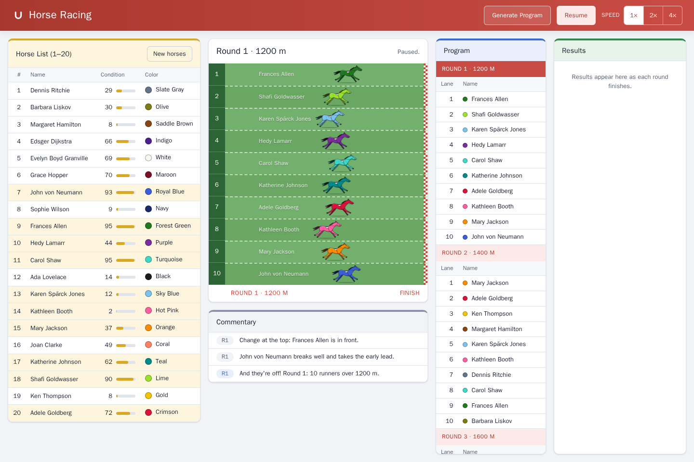

# Horse Racing

A horse racing game built with Vue 3, TypeScript and Pinia. There are twenty horses in the stable, six rounds in a program, ten runners in each round, and a commentator who calls the race as it happens.



## Getting started

You'll need Node.js 24 (it's pinned in `.nvmrc`, but 22.18+ works too) and npm.

```bash
npm ci
npm run dev
```

Then open http://localhost:5173. To get the same horses, programs and races every time, add `?seed=42` to the URL. Any unsigned 32-bit integer works.

### Scripts

| Script                       | What it does                                                       |
| ---------------------------- | ------------------------------------------------------------------ |
| `npm run dev`                | Vite dev server with hot reload                                    |
| `npm run build`              | Type-checks, then builds for production into `dist/`               |
| `npm run preview`            | Serves the production build on port 4173                           |
| `npm run type-check`         | `vue-tsc` over the app, tests and configs, plus `tsc` over the E2E |
| `npm run lint`               | oxlint, then ESLint, with zero warnings allowed                    |
| `npm run lint:fix`           | The same, applying automatic fixes                                 |
| `npm run format`             | Prettier                                                           |
| `npm run test:unit`          | Vitest in watch mode                                               |
| `npm run test:coverage`      | Vitest once, failing if coverage drops below the thresholds        |
| `npm run test:e2e`           | Playwright end-to-end tests against the production build           |
| `npm run test:visual:docker` | Visual regression tests inside the official Playwright Linux image |

There's also a pre-commit hook (husky + lint-staged) that lints and formats whatever you've staged.

## How it plays

When the page loads, it generates a stable of 20 horses. Each one gets a unique name, a unique colour and a condition score between 1 and 100.

**Generate Program** draws six rounds at 1200, 1400, 1600, 1800, 2000 and 2200 m, with 10 of the 20 horses picked at random for each. Press **Start** and the rounds run one after another. The horses gallop down their lanes, and as soon as the last one crosses the line, the result shows up under **Results**. You can **Pause** and **Resume** at any point, and the speed switch runs the race at 1×, 2× or 4×.

Meanwhile the commentator calls the start, the early leader, any lead changes, the final stretch, photo finishes and the winner. If you want a different field, **New horses** brings in a fresh stable.

Your progress is saved in the browser, so reloading the page puts you back where you were, paused.

## Architecture

The code is organised by feature rather than by file type. Each feature owns its model, its store and its UI, and only exposes what the others need through its `index.ts`.

```
src/
  app/            Application shell: header, global styles and design tokens
  shared/         Feature-agnostic building blocks
    lib/          Seeded random numbers, seed handling, formatting, logging, DOM helpers
    composables/  useAnimationLoop, useEventListener
    persistence/  Validated localStorage access and type guards
    ui/           BaseButton, BasePanel and a generic, typed DataTable
  features/
    horses/       The stable: generation, store, horse list
    race/         Schedule, race simulation, state machine, track, program and results
    commentary/   Event detection, wording, live feed
    game/         Session orchestration: seeds, save/restore, the game loop, controls
  App.vue         Composition root that lays the features out
```

Features only depend on each other in one direction: `horses` ← `race` ← `commentary` ← `game`, where each arrow points from a feature to the one that uses it. Nothing points back. ESLint enforces the public APIs, so importing `@/features/race/store/...` from another feature is a lint error. You have to go through `@/features/race`.

Inside a feature, the code is split into three layers:

- `model/` is plain TypeScript with no Vue and no timers. It holds the types, constants and pure functions like `createSchedule`, `planRace`, `progressAt` and `detectEvents`. Most of the logic lives here, which also makes it the easiest part to test.
- `store/` has the Pinia setup stores, which hold the state and expose actions named after what they do.
- `ui/` has the components. Most of them are presentational and only take props (`RaceLane`, `RoundTable`, `DataTable` and so on). A few containers, like `RaceTrack`, `ProgramPanel` and `HorseList`, read their own feature's store. Anything that crosses features is passed in from `App.vue`.

### State management

There are four stores:

| Store        | What it does                                                                                           |
| ------------ | ------------------------------------------------------------------------------------------------------ |
| `horses`     | The 20 horses. They never change once generated, so they sit in a `shallowRef` and are replaced whole. |
| `race`       | The program, the race plans, the results and the race state machine.                                   |
| `commentary` | The commentary feed, capped at 50 lines.                                                               |
| `game`       | Runs a session: owns the seeds, generates programs, moves time forward and builds save snapshots.      |

The race store is a small state machine:

```
idle ──generate──▶ ready ──start──▶ running ⇄ paused
                                      │
                                      └─ six rounds done ─▶ finished ──generate──▶ ready
```

A transition that isn't allowed from the current state is simply ignored, so a double click can't start two loops or skip a round.

Time only moves forward through `tick(deltaMs)`. In the app, `useAnimationLoop` calls it once per `requestAnimationFrame`, with the frame delta capped at 100 ms so that switching back to a background tab doesn't teleport the horses to the finish. The tests call `tick` directly with however much time they need.

### Race simulation

Every round is planned up front, when the program is generated. Each horse gets a cruising speed of `15 + 3 × condition / 100` m/s, a form-on-the-day factor moves that up or down by up to 3%, and the distance is split into 200 m segments that each vary by up to 8%.

That gives believable times (about 70 s for 1200 m) and some lead changes along the way. A 20-point gap in condition is worth roughly 3.5% of speed, so the better horse usually wins, but upsets happen. The unit tests check both of these statistically.

Since the whole race is known in advance, a horse's position is a pure function of the race clock: `progressAt(run, distance, elapsedMs)`. Pausing, resuming, changing speed and restoring a saved session all come down to setting one number.

All the randomness goes through a seeded generator (mulberry32). The horses come from the session seed, and the n-th program comes from `deriveSeed(seed, n)`. That means any session can be replayed from `?seed=`, which is what the E2E and visual tests rely on.

### Commentary

`detectEvents(previous, next, plans, memory)` compares two consecutive moments of a race and returns typed events: round start, early lead, lead change, final stretch, photo finish, winner and program complete. Lead calls are throttled so the feed stays readable.

The wording lives separately in `formatEvent`. The events themselves don't carry any copy, so translating them later would be straightforward. The feed is an `aria-live="polite"` region, which means screen reader users hear the race too.

### Persistence

A saved session is only `{ version, seed, programCount, race progress }`. The horses, rounds and race plans are rebuilt from the seeds on load, so the payload is a few hundred bytes and there's nothing in it worth tampering with.

Stored data is still treated as untrusted. It's size-limited, parsed inside a `try`, checked with type guards and then checked again against the regenerated program. Anything that doesn't fit gets thrown away. A race that was running when you left comes back paused.

If you change how things are generated or how the race model works, bump `SNAPSHOT_VERSION` so that old saves are discarded instead of restored.

## Testing

| Layer             | Tooling                       | What it covers                                                                                             |
| ----------------- | ----------------------------- | ---------------------------------------------------------------------------------------------------------- |
| Unit & component  | Vitest, Vue Test Utils        | Models, stores, composables and components (236 tests, about 99% statement coverage, thresholds per layer) |
| End-to-end        | Playwright (Chromium)         | Full game flows, pause/resume, reload & restore, keyboard-only play, CSP and third-party request checks    |
| Visual regression | Playwright `toHaveScreenshot` | The initial, program, mid-race and finished screens at desktop and mobile sizes                            |

The E2E and visual tests run against the production build (`vite preview`), so the Content Security Policy is enforced while they run. They use a fixed seed and Playwright's fake clock. Nothing moves until a test advances time, so every race and every screenshot comes out the same from run to run.

The visual baselines are rendered on Linux in `mcr.microsoft.com/playwright:v1.64.1-noble`, the same image CI uses, so they don't depend on whatever OS you happen to be on. Run them with `npm run test:visual:docker`. After an intentional UI change, refresh them with `npm run test:visual:docker -- --update-snapshots`.

CI (`.github/workflows/ci.yml`) runs lint, the format check, the type check, unit tests with coverage, the build and a production dependency audit, and then the E2E and visual suites.

## Security

There's no HTML injection surface: no `v-html` (it's an ESLint error), no `eval` and no dynamically created `<script>`. Everything is rendered through Vue's escaped interpolation.

Production builds include a CSP `<meta>` tag that only allows `'self'`, with no `unsafe-inline` and no `unsafe-eval`. Dynamic styles are applied through CSSOM (`:style` bindings), which the policy allows. The dev server is left out, because Vite injects inline styles for hot reload.

`?seed=` only accepts digits within the uint32 range and ignores anything else. Saved sessions are validated as described above.

The app makes no third-party requests at all. It uses the system font stack and inline SVG, and nothing comes from a CDN. An E2E test checks this.

The `Dockerfile` builds the app and serves it from `nginx-unprivileged` as a non-root user:

```bash
docker build -t horse-racing-game .
docker run --rm -p 8080:8080 horse-racing-game
```

The nginx config in `deploy/nginx` adds the security headers: a CSP that includes `frame-ancestors 'none'`, plus `X-Content-Type-Options`, `X-Frame-Options`, `Referrer-Policy`, `Permissions-Policy`, COOP and CORP. Hashed assets are cached as immutable and `index.html` is served with `no-cache`. HSTS isn't set here, since it belongs on whatever terminates TLS in front of the container.

The only runtime dependencies are `vue` and `pinia`, and CI runs `npm audit --omit=dev`.

## Accessibility

The page uses semantic landmarks and a single `h1`, and the tables have captions, column headers and row headers. Colours are always shown next to their names, so nothing depends on colour alone.

You can play the whole game with the keyboard: the controls are native buttons and the speed switch is a radio group. Focus is clearly visible. With `prefers-reduced-motion` on, the gallop and scrolling animations are turned off.

## Assumptions

- The brief says the horse list "should contain between 1 to 20 horses", and also that "the game should have a total of 20 horses". I took the first one to describe the numbering in the example ("Horse List (1–20)"), so the game always generates 20. The count is a single constant (`HORSE_COUNT`), though, and `createHorses` accepts any count up to the size of the name and colour pools.
- In the program, the position column is the starting lane. In the results, it's the finishing position, followed by the race time.
- There's a short break between rounds (1.5 s at 1×) so you can read each result before the next one starts.
